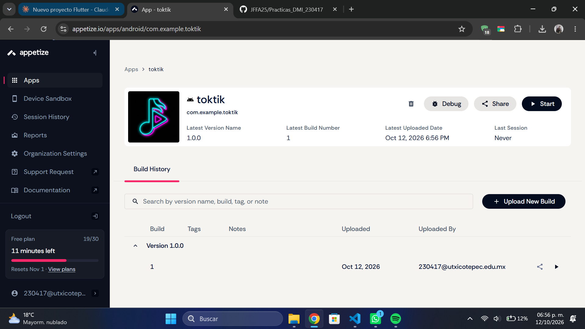
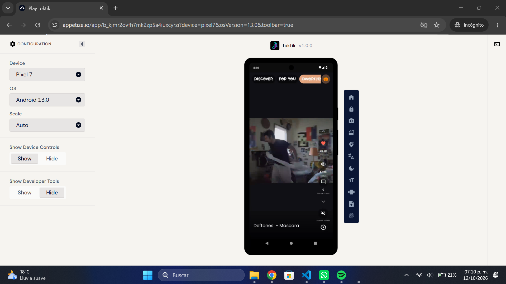
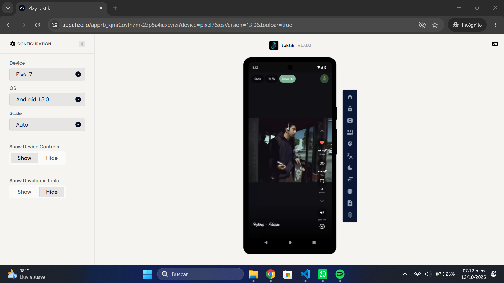
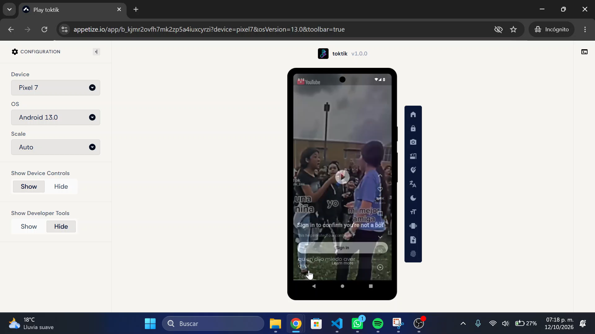
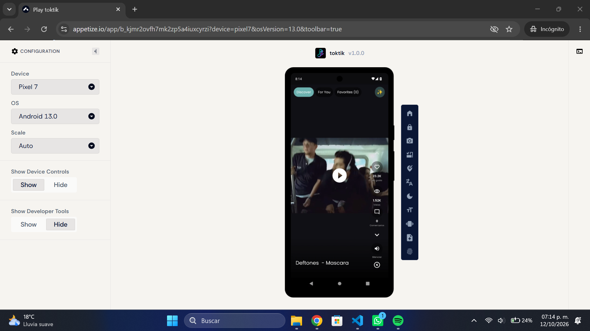

## Pruebas funcionales en Appetize

**Aplicación:** TokTik v1.0.0 
**Enlace público:** https://appetize.io/app/b_kjmr2ovfh7mk2zp5a4iuxcyrzi 
**Dispositivo:**  Pixel 7 - Android 13.0 

### 1. Carga de las APIs

**Objetivo:** comprobar que la app consume correctamente los servicios externos (YouTube Data API y Giphy) en la versión release.
**Pasos:** abrir la app y esperar a que cargue el contenido del feed.
**Resultado esperado:** aparecen los videos con su información; no hay mensajes de error ni pantallas vacías.

### 2. Pantalla de carga (splash)

**Objetivo:** verificar la pantalla de bienvenida al abrir la app y la que aparece al cambiar de tema.
**Pasos:** abrir la app y observar la pantalla inicial; después cambiar el tema (Halloween / Navidad).
**Resultado esperado:** se muestra el splash con el ícono de la temática y luego pasa al contenido.

### 3. APK subido a Appetize

**Objetivo:** evidenciar que el APK de release fue procesado y publicado.
**Pasos:** subir `app-release.apk` en Appetize (Apps → Upload) y abrir la página de la app.
**Resultado esperado:** la app aparece con su nombre, versión y fecha de carga, y el enlace público funciona.
**Resultado:** 

### 4. Favoritos (likes y persistencia local)

**Objetivo:** comprobar que los videos con like se guardan en Favoritos y se conservan en el almacenamiento local.
**Pasos:**
1. Dar like a uno o varios videos del feed.
2. Abrir la sección de Favoritos y comprobar que aparecen.
3. Cerrar la app desde recientes y volver a abrirla **sin cerrar la sesión de Appetize**.
4. Revisar de nuevo Favoritos.

**Resultado esperado:** los videos con like siguen en Favoritos después de reabrir la app.

> Nota: al iniciar una sesión nueva en Appetize la app arranca desde cero, por lo que la persistencia se prueba dentro de la misma sesión.

### 5. Mostrar más contenido (título y descripción)

**Objetivo:** verificar que se pueda ver la información completa del video.
**Pasos:** en un video, abrir la opción de "mostrar más".
**Resultado esperado:** se muestran el título y la descripción del video.
**Resultado:** ☐ Dispositivo A ☐ Dispositivo B

### 6. Botón de pausa

**Objetivo:** comprobar que el video se pueda pausar y reanudar.
**Pasos:** tocar el botón de pausa durante la reproducción y después tocarlo otra vez.
**Resultado esperado:** el video se detiene y el ícono cambia; al tocarlo de nuevo se reanuda.

### 7. Botón de silenciar

**Objetivo:** comprobar que el audio se pueda silenciar y reactivar.
**Pasos:** tocar el botón de silencio durante la reproducción y después tocarlo otra vez.
**Resultado esperado:** el audio se silencia y el ícono cambia; al tocarlo de nuevo se reactiva.

