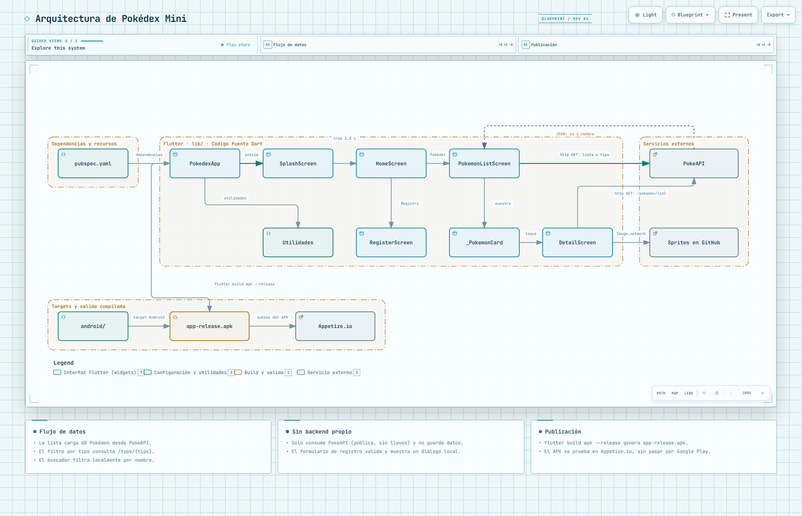

# Pokédex Mini

App Flutter que consume [PokeAPI](https://pokeapi.co/): lista de Pokémon con buscador y filtro por tipo, pantalla de detalle y formulario de registro con validación.


## Diagrama de Arquitectura

[Ver diagrama interactivo en GitHub Pages](https://jffa25.github.io/Practicas_DMI_230417/Practica-Appetize/appetize/docs/arquitectura.html)

[](https://jffa25.github.io/Practicas_DMI_230417/Practica-Appetize/appetize/docs/arquitectura.html)

# Práctica: publicación y validación con Appetize

## Enlace de la app publicada

**Build v1.0.1:** https://appetize.io/app/b_z6febjqdrw5njy6kwfhrxeubbq

## Procedimiento

1. **Validación local**
   ```bash
   flutter pub get
   flutter analyze
   flutter run -d chrome
   ```
2. **Configuración:** se agregó el permiso de internet en `android/app/src/main/AndroidManifest.xml` (necesario en modo release) y se subió la versión a `1.0.1+2` en `pubspec.yaml`. La API es pública, sin credenciales en el proyecto.
   ```xml
   <uses-permission android:name="android.permission.INTERNET"/>
   ```
3. **Generar el APK**
   ```bash
   flutter build apk --release
   ```
   Ubicación: `build/app/outputs/flutter-apk/app-release.apk` (v1.0.0: 48.9 MB, v1.0.1: PENDIENTE_TAMAÑO MB).
4. **Appetize:** cuenta en appetize.io → Apps → Upload (Upload New Build para nuevas versiones) → elegir dispositivo → Start → Share → Play URL, verificada en ventana de incógnito.


## Pruebas funcionales

**Dispositivo A:** Pixel 11 Pro, Android 17.0
**Dispositivo B:** PENDIENTE

### Dispositivo A

**Carga de lista desde la API**


**Buscador y filtro por tipo**


**Detalle de un Pokémon**


**Validación del formulario (datos incorrectos)**


**Validación del formulario (registro exitoso)**


**Rotación y adaptación de pantalla**


### Dispositivo B

**Pruebas en el segundo dispositivo**

**Carga de lista desde la API**


**Buscador y filtro por tipo**


**Detalle de un Pokémon**


**Validación del formulario (datos incorrectos)**


**Validación del formulario (registro exitoso)**


**Rotación y adaptación de pantalla**


## Incidencias y correcciones

| Incidencia | Solución |
|---|---|
| `device 'emulator-5554' not found` (emulador ONE GameLoop) | Se probó en Chrome; el APK se genera sin emulador |
| Error en `pubspec.yaml` por `flutter_launcher_icons` dentro de `dev_dependencies` | Se movió el bloque al final del archivo, sin indentación |
| `PathNotFoundException` del ícono en formato webp | Se convirtió a PNG real |
| PENDIENTE (agregar las de Appetize) | |

Tras las mejoras se compiló una nueva versión (1.0.1) y se subió como nuevo build.

## Control de versiones

```bash
git checkout -b practica-appetize
git add .
git commit -m "Práctica Appetize: documentación y evidencias"
git push origin practica-appetize
```


Integración mediante merge / Pull Request:


## Conclusión

Appetize permite probar la app en Android desde el navegador, sin teléfono físico ni Google Play y con un enlace fácil de compartir. Sus límites: 30 minutos de uso en el plan gratuito, un enlace distinto por cada build y sensores de hardware limitados.


## Autor

- Jose Francisco Flores Amador