<div align="center">

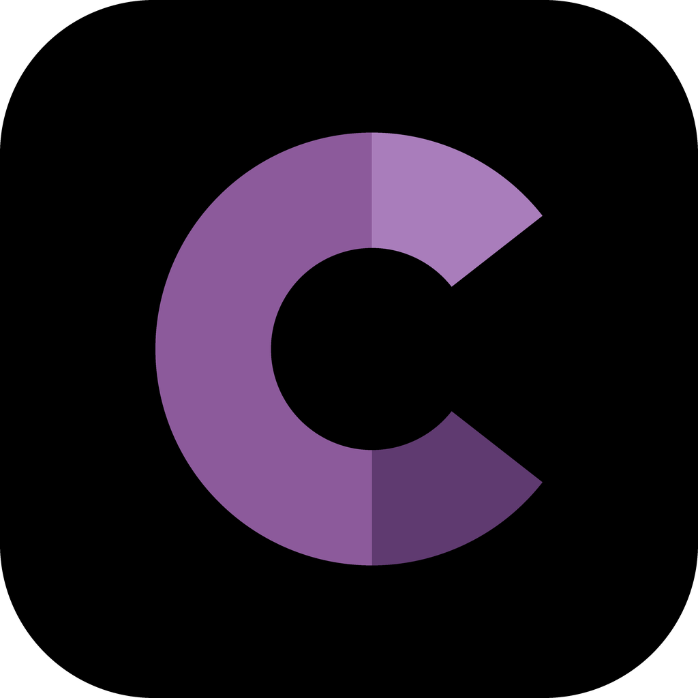

# Cinemapedia

**Tu enciclopedia de Cine, En una sola app.**
Descubre qué hay en cines, qué viene pronto y qué películas son las mejor calificadas, en 5 idiomas.


</div>

## Sobre la app

**Cinemapedia** es una aplicación de películas hecha con Flutter que consume la API de
[The Movie DB](https://www.themoviedb.org/). Muestra la cartelera, los próximos estrenos y las
películas mejor calificadas, y permite ver el detalle de cada película con su reparto, tráilers y
películas similares.

La app está disponible en **5 idiomas** (español de México, inglés, alemán, chino y árabe) y se
cambia desde el menú lateral: se traducen tanto los textos de la app como los datos de las
películas que llegan de la API.

## Capturas

<table style="width: 100%; max-width: 750px; border-collapse: collapse; margin: 0 auto; color: white;">
  <!-- Primera fila: 3 pantallas -->
  <tr>
    <th style="padding: 10px; text-align: center; width: 33.33%;">Pantalla de Carga</th>
    <th style="padding: 10px; text-align: center; width: 33.33%;">Inicio y Navegación</th>
    <th style="padding: 10px; text-align: center; width: 33.33%;">Detalles de la Película</th>
  </tr>
  <tr>
    <td align="center" style="padding: 10px;">
      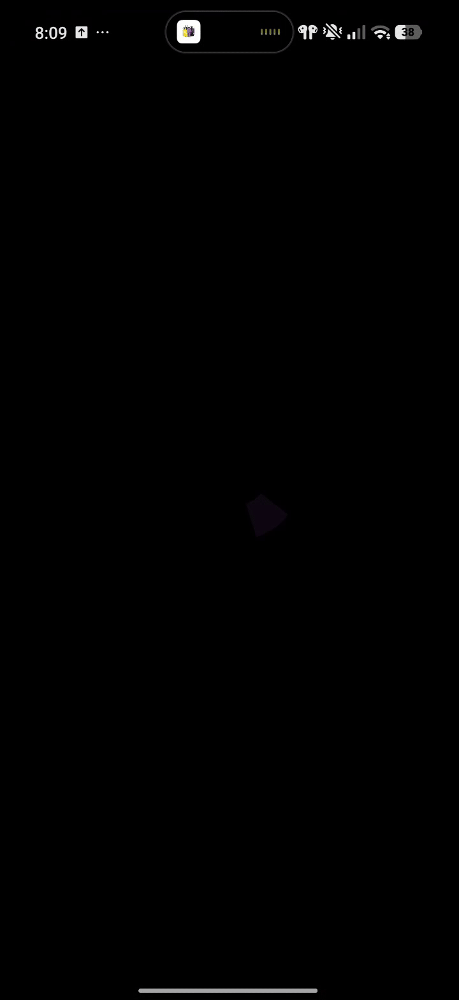
    </td>
    <td align="center" style="padding: 10px;">
      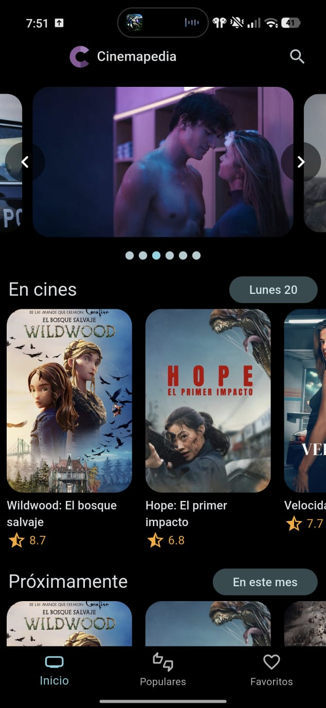
    </td>
    <td align="center" style="padding: 10px;">
      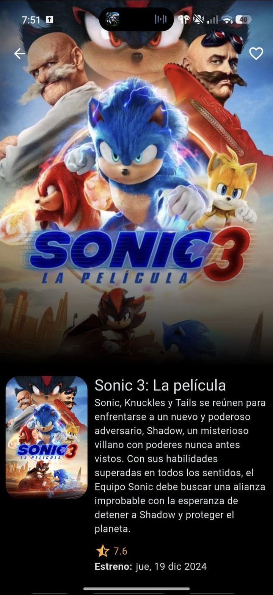
    </td>
  </tr>

  <!-- Segunda fila: Favoritos y menú lateral -->
  <tr>
    <th style="padding: 25px 10px 10px 10px; text-align: center; width: 33.33%;">Elenco</th>
    <th style="padding: 25px 10px 10px 10px; text-align: center;">Favoritos</th>
    <th style="padding: 25px 10px 10px 10px; text-align: center;">Menú Lateral</th>
  </tr>
  <tr>
    <td align="center" style="padding: 10px;">
      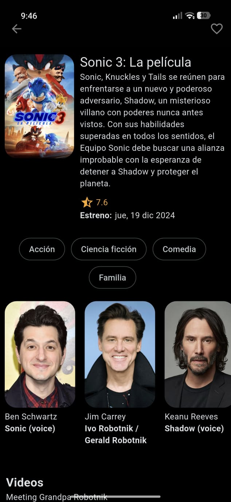
    </td>
    <td align="center" style="padding: 10px;">
      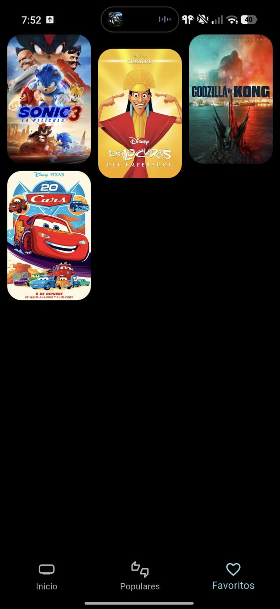
    </td>
    <td align="center" style="padding: 10px;">
      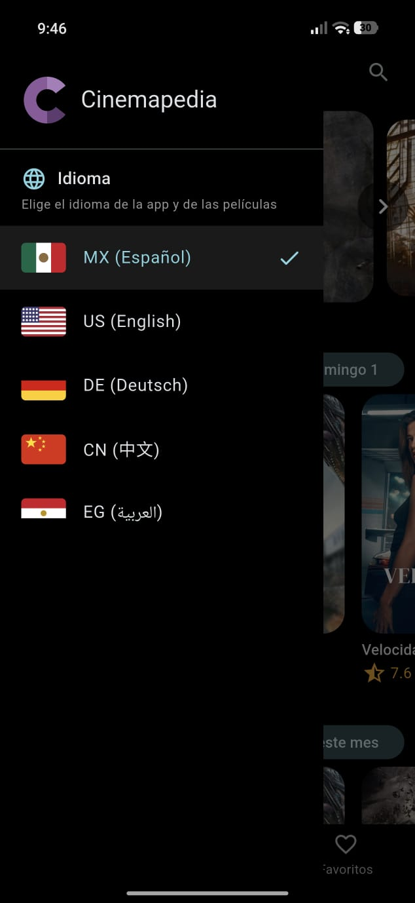
    </td>
  </tr>
</table>

### Idiomas

La app cambia de idioma desde el menú lateral, y se traducen los textos y los datos de las películas.

<table style="width: 100%; max-width: 750px; border-collapse: collapse; margin: 0 auto; color: white;">
  <!-- Primera fila de idiomas -->
  <tr>
    <th style="padding: 10px; text-align: center; width: 33.33%;">MX (Español)</th>
    <th style="padding: 10px; text-align: center; width: 33.33%;">US (English)</th>
    <th style="padding: 10px; text-align: center; width: 33.33%;">DE (Deutsch)</th>
  </tr>
  <tr>
    <td align="center" style="padding: 10px;">
      
    </td>
    <td align="center" style="padding: 10px;">
      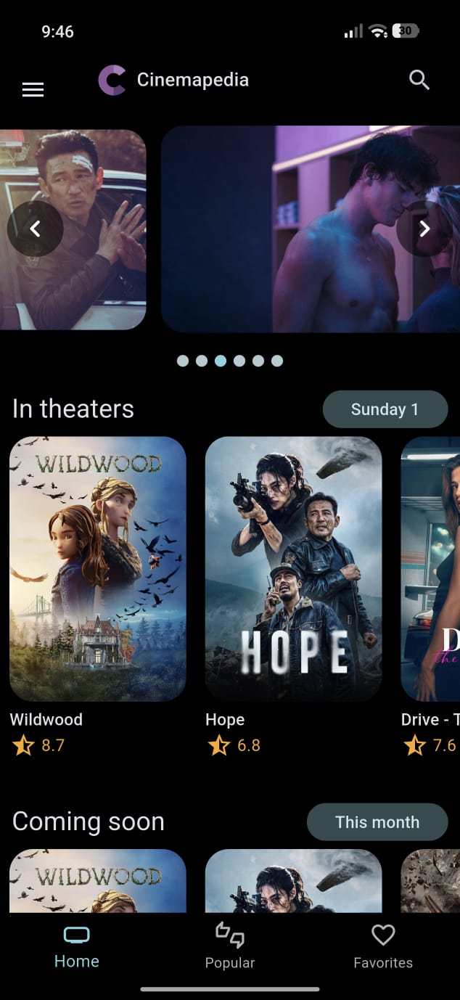
    </td>
    <td align="center" style="padding: 10px;">
      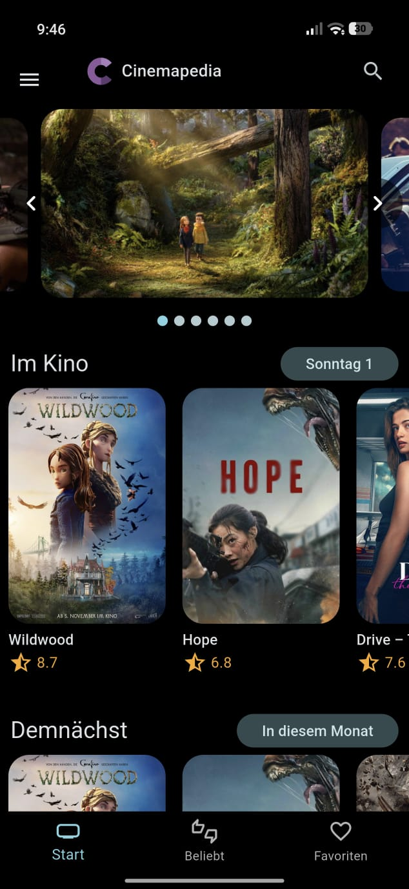
    </td>
  </tr>

  <!-- Segunda fila de idiomas -->
  <tr>
    <th style="padding: 25px 10px 10px 10px; text-align: center;">CN (中文)</th>
    <th style="padding: 25px 10px 10px 10px; text-align: center;">EG (العربية)</th>
    <th style="padding: 25px 10px 10px 10px; text-align: center;">APK</th>
  </tr>
  <tr>
    <td align="center" style="padding: 10px;">
      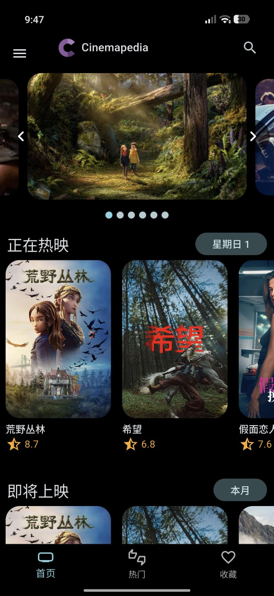
    </td>
    <td align="center" style="padding: 10px;">
      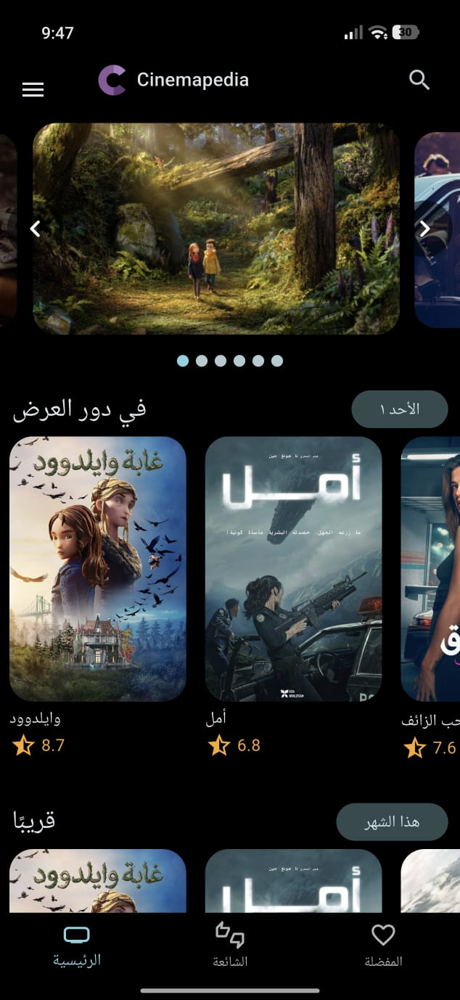
    </td>
    <td align="center" style="padding: 10px;">
      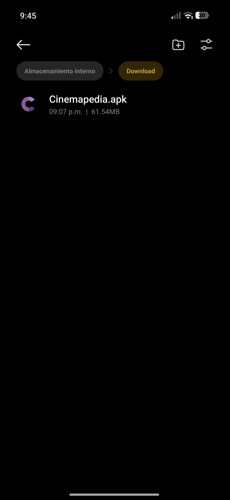
    </td>
  </tr>
</table>

## Funcionalidades

- **Pantalla de carga animada:** la "C" de Cinemapedia se dibuja sobre fondo negro, aparece el
  nombre y hace zoom hacia la pantalla principal. Mientras cargan las películas, la "C" late
  en el centro de la pantalla.
- **Carrusel de estrenos** con autoplay y flechas para cambiar de película.
- **Listas horizontales** con scroll infinito: _En cines_, _Próximamente_ y _Mejor calificadas_.
- **Populares** en una vista de cuadrícula tipo masonry.
- **Detalle de película:** sinopsis, géneros, reparto, tráilers de YouTube y películas similares.
- **Búsqueda** de películas con sugerencias en tiempo real.
- **Favoritos** guardados en el dispositivo (base de datos local con Isar).
- **Menú lateral** que se abre con el botón de la barra o deslizando desde el borde de la pantalla.
- **Selector de idioma** con banderas: español, inglés, alemán, chino y árabe (ver [Idiomas](#idiomas-de-la-app)).
- **Tema oscuro** con fondo negro puro y acentos morados.

## Idiomas de la app

Al elegir un idioma en el menú lateral cambia **todo**: los textos de la app (menú inferior,
secciones, búsqueda, favoritos, pantalla de carga, detalle) y los datos de la API (títulos,
sinopsis, géneros, reparto y tráilers). Las películas se recargan solas con el nuevo idioma.

| Bandera | Idioma  | Código API |
| :-----: | ------- | :--------: |
|   MX    | Español |  `es-MX`   |
|   US    | English |  `en-US`   |
|   DE    | Deutsch |  `de-DE`   |
|   CN    | 中文    |  `zh-CN`   |
|   EG    | العربية |  `ar-EG`   |

- **Respaldo en inglés:** si una película no tiene traducción en el idioma elegido, The Movie DB
  devuelve el título original y la sinopsis vacía. En ese caso la app pide también la versión en
  inglés y la usa como respaldo.
- **Diseño de izquierda a derecha:** la pantalla no se voltea, ni siquiera en árabe.
- **Fechas:** el formato de fecha del detalle y la etiqueta del día en _En cines_ siguen el idioma elegido.
- El idioma elegido no se guarda: al cerrar la app vuelve a español (MX).
- Los favoritos conservan el título y la sinopsis en el idioma en que se guardaron.

### Cómo agregar otro idioma

1. Agrégalo a la lista `AppLanguages.all` en `lib/config/i18n/app_language.dart`.
2. Agrega sus textos en `lib/config/i18n/app_strings.dart` (mapa `_values` y lista `supportedCodes`).
3. Si usa una bandera nueva, dibújala en `lib/presentation/widgets/shared/flag_icon.dart`.

## Icono de la App

El icono de Cinemapedia es una **"C" de papel cortado** en tonos morados, con sombreado de
papel doblado: un tono más oscuro en la punta de abajo y uno más claro en la de arriba, sobre
fondo negro.

<div align="center">


</div>

- Es el mismo dibujo en toda la app: icono del sistema, barra superior, menú lateral y pantalla
  de carga (se dibuja en código con `CustomPainter`, por eso se ve nítido a cualquier tamaño).
- El loader de los pósters (`assets/loaders/bottle-loader.gif`) también está en morado.
- El archivo base en 1024 px está en [`assets/icon/app_icon.png`](assets/icon/app_icon.png).
- Hay versiones para Android (adaptativo), iOS, macOS, Windows (`.ico`) y web.

## Paleta de colores

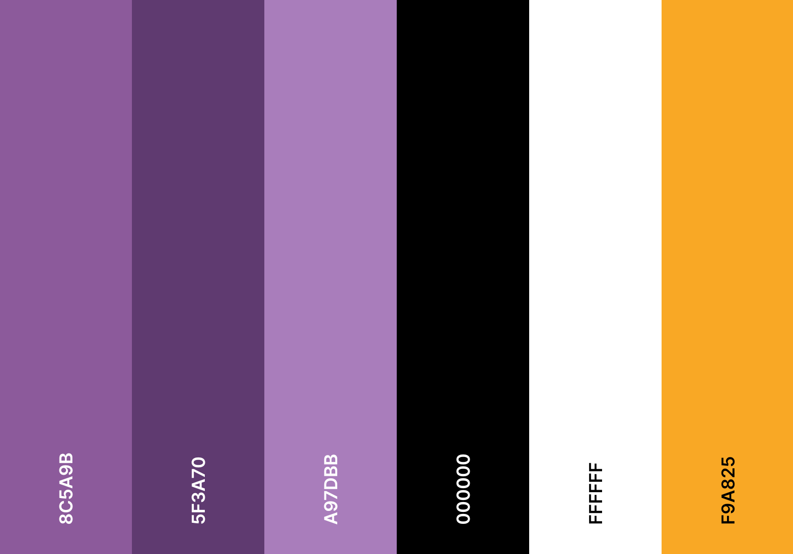

| Color                     |     Hex      | Uso                                                                                                                 |
| :------------------------ | :----------: | :------------------------------------------------------------------------------------------------------------------ |
| **Morado base**           | 🟪 `#8C5A9B` | Cuerpo de la "C", color de la marca y semilla del tema                                                              |
| **Morado oscuro**         | 🟪 `#5F3A70` | Sombra de la punta inferior de la "C"                                                                               |
| **Morado claro**          | 🟪 `#A97DBB` | Brillo de la punta superior de la "C" y color principal de la interfaz (puntos del carrusel, menú inferior, iconos) |
| **Negro**                 | ⬛ `#000000` | Fondo de la app, de la pantalla de carga y del icono                                                                |
| **Blanco**                | ⬜ `#FFFFFF` | Textos e iconos sobre fondo oscuro                                                                                  |
| **Amarillo calificación** | 🟨 `#F9A825` | Estrellas y puntuación de las películas                                                                             |

## Tecnologías

| Para qué             | Paquete                          |
| -------------------- | -------------------------------- |
| Estado               | `flutter_riverpod`               |
| Navegación           | `go_router`                      |
| Peticiones HTTP      | `dio`                            |
| Base de datos local  | `isar_community`                 |
| Carrusel             | `card_swiper`                    |
| Animaciones          | `animate_do`                     |
| Cuadrícula           | `flutter_staggered_grid_view`    |
| Tráilers             | `youtube_player_flutter`         |
| Variables de entorno | `flutter_dotenv`                 |
| Fechas e idiomas     | `intl` y `flutter_localizations` |

## Arquitectura

**[Ver el diagrama interactivo en GitHub Pages](https://jffa25.github.io/Practicas_DMI_230417/Practica06/Arquitectura/Arquitectura_de_Cinemapedia.html)**: Vistas guiadas (flujo de películas, cambio de idioma, favoritos, pósters y tráiler), detalle de cada caja y modo presentación.

<div align="center">

<a href="https://jffa25.github.io/Practicas_DMI_230417/Practica06/Arquitectura/Arquitectura_de_Cinemapedia.html">
  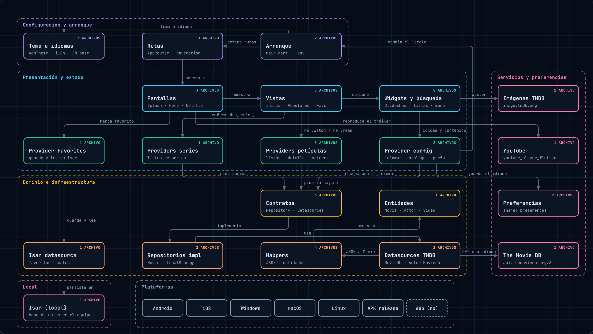
</a>

</div>

La app se divide en capas: **configuración y arranque**, **presentación y estado** (pantallas, vistas,
widgets y providers de Riverpod), **dominio e infraestructura** (contratos, repositorios, datasources y
mappers), **servicios externos** (The Movie DB, imágenes de TMDB y YouTube) y **almacenamiento local**
con Isar. Los providers piden las películas al repositorio, que las trae de The Movie DB y las
convierte a entidades con mappers.

## Requisitos

- **Flutter estable reciente** (el proyecto está configurado con la plantilla de Flutter 3.47:
  Dart ^3.10, Gradle 9.3.1, AGP 9.1.0, Kotlin 2.4.0). Si tu Flutter es más viejo: `flutter upgrade`.
- **JDK 17 o superior** (el que trae Android Studio sirve).
- Android SDK 36 (Android Studio lo instala solo cuando se lo pide el build).
- Una API key gratuita de [The Movie DB](https://www.themoviedb.org/settings/api).

## Cómo ejecutarlo

1. Crea un archivo `.env` en la raíz del proyecto con tu API key:
   ```
   THE_MOVIEDB_KEY=tu_api_key
   ```
2. Instala las dependencias:
   ```
   flutter pub get
   ```
3. Ejecútalo en Windows, en un emulador o en tu celular (con depuración USB activada):
   ```
   flutter devices
   flutter run
   ```

> **La web no está soportada:** Isar no corre en navegador.

## Generar el APK

```
flutter build apk --release
```

El archivo queda en `build/app/outputs/flutter-apk/app-release.apk`. Para un APK más ligero
(uno por arquitectura) usa `flutter build apk --release --split-per-abi`.

> El `.env` va dentro del APK, así que no lo subas a una tienda pública. Además, el APK sale
> firmado con la llave de depuración: sirve para instalarlo y mostrarlo, no para publicarlo.

## Créditos

- Datos de películas: [The Movie DB](https://www.themoviedb.org/). Esta app usa la API de TMDB
  pero no está avalada ni certificada por TMDB.
- Desarrollado por **Jose Francisco Flores Amador** ([@JFFA25](https://github.com/JFFA25)).